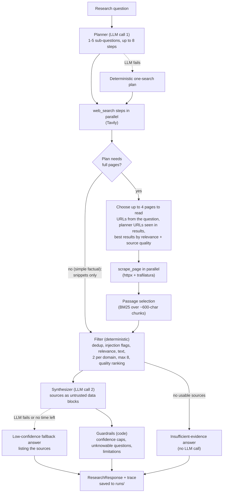

# Research Agent

A single-agent research assistant. It takes a research question, plans
sub-questions, searches the web (Tavily), reads the most promising pages when
the question needs them (the planner decides; simple factual questions are
answered from search snippets), filters weak or suspicious sources, and returns a structured answer: a short
answer, key findings each citing sources, a confidence level with its reason,
assumptions, limitations and next steps. Every run also writes a full trace
(plan, tool calls, filter decisions, LLM calls, guardrails, timings).

- Python 3.11+ (developed and tested on 3.14), Pydantic v2, no agent framework
- LLM through the OpenAI SDK against any OpenAI-compatible endpoint
  (default: Groq primary, Google Gemini fallback, both free tiers)
- 161 offline tests; an evaluation harness with a no-tools baseline and
  before/after results in [`EVALUATION.md`](EVALUATION.md)
- Design decisions and their reasons, phase by phase: [`NOTES.md`](NOTES.md)

---

## Setup

You need API keys for **Tavily** (search), **Groq** (primary LLM) and,
optionally, **Google Gemini** (fallback LLM). All three have free tiers:
- Tavily: https://tavily.com
- Groq: https://console.groq.com/keys
- Gemini: https://aistudio.google.com/apikey

### Windows (PowerShell)

```powershell
git clone https://github.com/PyushMehta/predixion_assignment.git
cd predixion_assignment
python -m venv .venv
.venv\Scripts\Activate.ps1          # if blocked: Set-ExecutionPolicy -Scope CurrentUser RemoteSigned
pip install -r requirements.txt
Copy-Item .env.example .env         # then edit .env and add your keys
```

### macOS / Linux

```bash
git clone https://github.com/PyushMehta/predixion_assignment.git
cd predixion_assignment
python3 -m venv .venv
source .venv/bin/activate
pip install -r requirements.txt
cp .env.example .env                # then edit .env and add your keys
```

### Environment variables (`.env`)

| variable | required | what it does |
|---|---|---|
| `TAVILY_API_KEY` | yes | Tavily search API key. |
| `LLM_BASE_URL` | yes | OpenAI-compatible endpoint of the primary LLM. Default `https://api.groq.com/openai/v1`. |
| `LLM_API_KEY` | yes | API key for the primary LLM. |
| `LLM_MODEL` | yes | Primary model. Default `openai/gpt-oss-120b`. |
| `LLM_FALLBACK_BASE_URL` | no | Endpoint of the fallback LLM, tried once when the primary is unavailable. Default `https://generativelanguage.googleapis.com/v1beta/openai/` (Gemini). |
| `LLM_FALLBACK_API_KEY` | no | Fallback key. Leave empty to disable the fallback. |
| `LLM_FALLBACK_MODEL` | no | Fallback model. Default `gemini-3.5-flash-lite`. |
| `LLM_TEMPERATURE` | no | Sampling temperature for every LLM call. Default `0`. |
| `LLM_SIMULATE_PRIMARY_OUTAGE` | no | Demo only: `1` makes the primary LLM fail every request (connection error) so failover can be shown. Off by default; logged as `SIMULATED OUTAGE` when on. |
| `LOG_LEVEL` | no | Log level for the CLI (`INFO` by default; `-v` forces `DEBUG`). |

A provider is used only when all three of its variables (base URL, key,
model) are set. Switching provider, e.g. to OpenAI
(`https://api.openai.com/v1`, `gpt-4o-mini`), is a `.env` change; no code
changes are needed.

---

## Running

```bash
# Ask a question: readable answer on stdout, logs (one line per step) on stderr
python main.py "Is nuclear power safer than wind per TWh of electricity?"

# Same, as raw JSON (a ResearchResponse)
python main.py "Compare the top 3 open-source vector databases for a startup building RAG products." --json

# Optional demo UI (the CLI above is the main interface)
streamlit run app.py

# Tests: offline, no keys needed (network and LLM are faked)
python -m pytest -q

# Evaluation: 8 queries through the real agent, ~5-10 minutes on free tiers
python eval/run_eval.py --baseline            # also answers each query with one no-tools LLM call
python eval/run_eval.py --only nonsense,prompt_injection
python eval/compare.py eval/results/20261029-213848.json eval/results/20261029-215619.json \
    --notes eval/results/comparison_notes.md  # before/after report -> eval/results/comparison.md
```

Each run writes:
- `outputs/<run_id>.md` and `.json`: the answer (CLI only)
- `runs/<run_id>.json`: the full trace

Both folders are git-ignored. Eval results go to `eval/results/` and are committed.

**Demo UI.** `streamlit run app.py` opens a thin page that calls
`orchestrator.run()` and displays the result:
- the answer, a confidence badge, findings with their source ids, and clickable sources
- expanders for the plan, the filter decisions, and timings/LLM calls/fallbacks

A sidebar checkbox, **Simulate primary LLM outage**, makes the primary
provider unreachable for that run, so you can watch it fail over to the
fallback. The page contains no agent logic. The outage switch lives in
`agent/llm.py` (`providers_from_env(simulate_primary_outage=True)`). For the
CLI or eval, set `LLM_SIMULATE_PRIMARY_OUTAGE=1`; the checkbox overrides it
per run.

Sample outputs from the latest evaluation run are in [`samples/`](samples/):
- [nuclear vs wind](samples/nuclear_vs_wind.md): normal answer
- [nonsense query](samples/nonsense_insufficient_evidence.md): insufficient evidence
- [2030 World Cup](samples/world_cup_2030_unknowable.md): low confidence on an unknowable question

---

## Architecture

A single agent in a fixed **plan → execute → filter → synthesize → check**
pipeline, with two LLM calls per run (planner and synthesis) and code doing
everything else.



All LLM calls go through `agent/llm.py`. It handles structured output,
validation with one repair retry, retries, the deadline, and failover to the
fallback provider.

### Modules

| module | role |
|---|---|
| `main.py` | CLI (main interface): argument parsing, logging, readable/JSON output, saves to `outputs/`. |
| `app.py` | Optional Streamlit demo UI: calls `orchestrator.run()` and displays the `RunResult`; no agent logic. |
| `agent/orchestrator.py` | `run(question) -> RunResult`: the pipeline, budgets (2 LLM calls, 4 scrapes, 90s per run), guardrails and trace. |
| `agent/planner.py` | `make_plan(question) -> Plan`; question in delimiters; tool/query check; decides `needs_full_pages`; fallback plan if the LLM fails. |
| `agent/llm.py` | `complete_structured(system, user, schema)`: the only LLM entry point. |
| `agent/filter.py` | Deterministic source filter; every drop recorded with a reason; numbers sources S1..Sn. |
| `agent/passages.py` | Keeps the question-relevant passages of a page (BM25, no LLM). |
| `agent/quality.py` | Source-quality categories and ranking adjustment; shared with the eval harness. |
| `agent/synthesizer.py` | `synthesize(question, sources) -> ResearchResponse`; citation checks; deterministic post-processing; fallback answers. |
| `agent/schemas.py` | Pydantic models for LLM output: `Plan`, `Source`, `Finding`, `ResearchResponse` (with grounding validators). |
| `agent/textutil.py` | `trim_at_sentence`. |
| `agent/tools/search.py` | `web_search(query) -> SearchResult` via the Tavily REST API. |
| `agent/tools/scraper.py` | `scrape_page(url) -> PageResult`: HTML only, 2 MB cap, 15s deadline, main-text extraction. |
| `agent/tools/net.py` | Shared HTTP retry helper (timeouts, 429, 5xx; optional deadline). |
| `agent/tools/injection.py` | Prompt-injection phrase check for web text (flags, never deletes). |
| `agent/tools/results.py` | Typed tool results: `SearchResult`, `SearchItem`, `PageResult`. |
| `eval/run_eval.py` | Evaluation harness: real agent per query, automatic checks, `--baseline`, `--only`, `--merge`. |
| `eval/compare.py` | Before/after report from two eval result files. |
| `eval/queries.yaml` | The 8 evaluation queries with expected behaviour. |

---

## Why did you choose an agentic approach here?

The questions need current, specific information from the web, and they
usually break into parts. "Compare the top 3 open-source vector databases"
needs a search per candidate and per angle, then reading a few pages. A
single LLM call can only answer from training data, and its claims can't be
traced. The no-tools baseline in the evaluation sounds fluent but cites
nothing. It gave an older nuclear-safety figure from memory, and on the
2030 World Cup it was well calibrated but had no evidence to offer.

The agentic part is deliberately small: one planner call decides *what to
look up*, and code executes the plan, reads pages, filters and checks. There
is no open-ended tool loop. That keeps cost and latency predictable (exactly 2
logical LLM calls, at most 4 page reads, a 90s budget) and makes failures easy
to locate in the trace. In the evaluation, after the Phase 5 fixes the agent
was clearly better than the no-tools baseline on 3 of 8 queries, worse on 1
and comparable on the rest. Its consistent advantage is traceability: the
manual review could only catch problems, such as a competitor's blog
describing a company, because the agent cited its sources.

## What tools did you use, and why?

- **Tavily search API**, for web search. It returns ranked results with
  relevance scores and content snippets, which the filter uses directly. It is
  called over plain `httpx` rather than the `tavily-python` SDK, so timeouts and
  retries are under our control and tests can fake the network.
- **Tool selection depends on the task.** The planner sets
  `needs_full_pages`: false for simple factual questions (snippets are
  enough, so no pages are fetched; e.g. "What is the capital of Australia?"
  took 6.1s with 0 pages read), and true for comparisons and research (up to
  4 pages read). Snippet-only answers are capped at medium confidence.
  A code rule overrides a "snippets" decision for comparison or numeric
  questions (compare, vs, pros and cons, top N, best, per, %, numbers with
  units, how many/much), because snippets rarely hold tables or both sides of
  a comparison.
- **httpx + trafilatura (BeautifulSoup fallback)**, for reading pages.
  trafilatura extracts the main article text; BeautifulSoup strips scripts,
  navigation and ad-like blocks when trafilatura finds nothing. Only HTML is
  read, and downloads are capped at 2 MB and a 15s deadline.
- **OpenAI SDK against OpenAI-compatible endpoints**, for the LLM, so the
  provider is configuration, not code. Groq (`openai/gpt-oss-120b`) is the
  primary because it was ~10× faster than Gemini Flash-Lite in our tests
  (2–4s vs 15–44s per planner call). Gemini (`gemini-3.5-flash-lite`) is the
  fallback, on a different company's infrastructure. Both are free tiers.
- **Pydantic v2**, for every LLM output schema and tool result. Responses are
  always re-validated in code, because the APIs don't enforce lengths or our
  own validators.
- No LangChain or agent framework: the flow is short enough that plain Python
  is easier to read, test and debug.

## How does the system handle bad tool results?

- **Tools never raise.** `web_search` and `scrape_page` return typed results
  with `ok` and `error`. Every failure becomes `ok=False` with a readable
  reason: timeout, HTTP status, non-HTML content, empty search, bad JSON,
  missing key, even an unexpected bug.
- **Retries only where they can help.** Timeouts, HTTP 429 and 5xx are retried
  with backoff (search: 2 retries; scrape: 1 retry within a 15s per-page
  deadline). 4xx errors, DNS failures and refused connections are not retried.
- **Bad pages are contained.** Non-HTML is skipped. Downloads are capped
  (2 MB, 15s). Pages too short to be real content (under 300 chars, e.g. cookie
  walls) fall back to the search snippet. Text with likely prompt-injection
  phrases is flagged and the filter drops it, recording the reason.
- **Degrades instead of failing:**
  - All scrapes fail → the answer is built from snippets and confidence is
    capped at medium.
  - No usable sources → an "insufficient evidence" answer without calling the LLM.
  - The planner fails → a deterministic one-search plan.
  - Synthesis fails or runs out of time → a low-confidence answer listing the sources.
- **Everything is recorded.** The trace lists each tool call (input, ok/error,
  latency), every skipped step and URL, and every filter drop with its reason.

## How do you reduce hallucinations?

- **Answer only from given sources.** The synthesizer prompt forbids outside
  knowledge, requires citing the given ids, and says to state weak or
  conflicting evidence instead of filling gaps.
- **The model can't invent sources.** It writes only the answer; the code
  attaches the real source list. A check built per call rejects any citation
  outside that list, and the error goes back to the model for one repair.
  `ResearchResponse`'s own validator then checks citations again.
- **Web text is data, not instructions.** Each source sits in a delimited block
  labelled untrusted. Delimiter look-alikes are stripped. Injection-flagged
  pages and snippets are dropped. Only URLs from search results or from the
  question are fetched, never URLs the LLM makes up.
- **Confidence is bounded by code:**
  - "high" needs 3+ *cited, full-page* sources from different sites, none
    of them the vendor of something the answer names (e.g. `milvus.io` for
    an answer about Milvus); otherwise it is lowered to medium, with the
    reason written into `confidence_reason`
  - fewer than 2 sources → low
  - snippets only → at most medium
  - questions about the future → low, with "predictions are not facts"
  - empty findings → low
- **Saying "I don't know" is a real outcome.** With no usable sources, the
  agent returns insufficient evidence without asking the LLM. The nonsense
  query in the evaluation got exactly that.
- **What it does not do:** check that each cited page actually supports its
  claim. The manual review found claims not present in the cited page (see
  Known limitations).

## How would you make this production-ready?

None of the following is built; this is the plan, in rough priority order.

1. **Claim-support check:** verify each finding against the text of its cited
   sources (an entailment pass or a cheaper overlap check), and drop or flag
   unsupported claims.
2. **Hard deadlines:** async I/O with cancellation, so in-flight HTTP and LLM
   calls stop at the budget. Today the deadline is enforced between steps, and
   a running request can overshoot slightly.
3. **Paid tiers and quotas:** free-tier rate limits caused most retries, and
   free-tier prompts may be used by the provider. Add per-tenant rate limiting
   and a request queue.
4. **Caching** of search results and page text, to cut cost and latency on
   repeated questions.
5. **Service packaging:** an HTTP API instead of the CLI, a container image,
   secrets from a secret manager instead of `.env`, and structured JSON logs.
6. **CI:** run the 161 tests on every change and a small eval subset nightly,
   failing the build on regressions in the automatic checks.
7. **Data-driven source quality:** replace the hand-made domain lists with
   learned or curated scores, and detect vendor/competitor bias.

## What would you monitor in production?

Most of these are already recorded in each run's trace; production would
aggregate them.

- **Latency:** per run and per stage (plan, search, scrape, synthesis); p50/p95;
  share of runs over the 90s budget.
- **Fallback rates:** planner fallback plan, provider failover, synthesis
  fallback answer, insufficient-evidence answers. A rise means a provider or
  search problem.
- **LLM errors by kind** (`availability`, `validation`, `deadline`, `other`),
  429 rate, repair-retry rate.
- **Tokens and cost** per run and per provider.
- **Tool health:** search failure and empty-result rate; scrape failure rate by
  domain (403s and paywalls).
- **Filter decisions:** drop reasons over time; injection flags (rising flags mean
  someone is trying to manipulate the agent); quality mix of kept sources.
- **Answer shape:** confidence distribution, sources per answer, share of
  snippet-only answers.
- **Quality:** periodic re-runs of the eval set with spot manual review, plus
  user feedback on answers.

## What were your key tradeoffs?

- **Fixed pipeline vs open-ended agent loop:** predictable cost and latency (2
  LLM calls, 4 page reads, 90s) and easy debugging, but no follow-up searches
  when the first round misses. Example: official vector-database docs were
  never found because the first searches didn't return them.
- **Deterministic code vs LLM judgement for filtering, passage selection and
  guardrails:** cheap, fast, testable and explainable, but cruder than an LLM
  re-ranker. The quality lists and the BM25 passage scorer are simple
  heuristics.
- **Free-tier providers:** no cost, but rate limits (Groq 429s), overload
  errors (Gemini 503s), slower fallback calls, and provider data use.
- **Non-strict JSON schema plus our own validation** instead of strict mode:
  works on both providers and with optional fields, at the cost of a possible
  repair call.
- **Evidence budget (2,000 chars per source, 8 sources)** to stay within
  free-tier token limits: more sources, less text from each. Passage selection
  makes those 2,000 chars count.
- **Temperature 0** for consistency, against Google's advice of 1.0 for Gemini 3
  models. Probes showed no problem and it can be changed in `.env`.
- **A small, honest evaluation:** 8 queries, one run each, one reviewer. It
  is enough to find and fix the big problems, not enough for statistical
  claims.

---

## Known limitations and future improvements

From the evaluation and [`NOTES.md`](NOTES.md):

- **Overconfidence (fixed in code, partly).** After Phase 5, all three "high"
  answers were judged overconfident in manual review (e.g. India HR-tech jumped
  to high on press releases, a competitor's blog and directory snippets),
  because the "3+ sources" rule counted snippet-only and vendor sources. "High"
  now needs 3+ cited, full-page sources from different, non-vendor sites. In the
  final eval run, it downgraded vector_dbs from high to medium (the GitHub repos
  cited were the products' own). *Still open:* vendors of *adjacent* products
  and consultancies aren't detected (two answers kept "high" on such sites),
  and vendor detection relies on capitalised names (a sentence-initial
  "Medium" could mark medium.com as a vendor).
- **Search coverage decides what can be found.** In the Phase 5 after run,
  Tavily returned no official documentation or GitHub pages for the vector-DB
  question, so the docs/GitHub boost had nothing to lift. Later runs did find
  GitHub and official docs, which shows search results vary between runs.
  *Fix:* add docs/GitHub-targeted queries to the plan for technical questions.
- **Tool selection depended on the planner model (mitigated).** In the final
  eval run (where the Gemini fallback did the planning), nuclear vs wind was
  judged "snippets are enough", so Our World in Data wasn't read. A code
  rule now forces full pages for comparison and numeric questions (compare,
  vs/versus, pros and cons, top N, best, per, %, numbers with units, how
  many/much) and records the override in the trace. Not yet re-run live: the
  Groq quota was exhausted. Questions outside those patterns still rely on
  the planner's judgement.
- **No entity checks.** For "Find 5 Indian B2B SaaS startups in HR tech", the
  before run included a company listed under Singapore, and the after run
  included two established vendors founded in 1994 and 2001. Constraints in
  the question (startup, country, count) aren't verified.
- **No claim-support check.** "Citations valid" means the ids exist, not that the
  page says it. The manual review found claims absent from their cited pages.
- **Vendor/competitor bias isn't detected:** for example, greytHR's own blog
  supplied Spine HR's positioning.
- **Heuristics:** the source-quality lists are hand-made (they miss some forums,
  e.g. `community.openai.com`). The unknowable-question check is a regex and can
  misfire on hypotheticals. The relevance threshold (0.5) is untuned.
- **Soft deadline for in-flight calls:** timeouts shrink to the time left and
  nothing new starts without time, but a running HTTP request isn't cancelled.
- **No JavaScript rendering; some sites block bots** (403/406 seen in the eval).
- **CSS-hidden text is extracted.** It can carry prompt injections, which are
  only caught by the keyword check.
- **No caching**, and one evaluation run per query.

---

## Note on how this was built

An AI coding assistant (Claude Code) wrote the implementation and tests, and
drafted the first-pass manual review of the evaluation answers. In that
review it spot-checked claims against the live cited pages; the reviews are
labelled `reviewer: Claude` in `eval/results/`. I wrote the phase-by-phase
specifications and made the key decisions: architecture constraints,
provider choice and order, schema changes, which evaluation findings to fix
and in what order, and what to measure. Implementation-level design choices
proposed by the assistant were reviewed and accepted by me; they are
documented with their reasons in [`NOTES.md`](NOTES.md).
